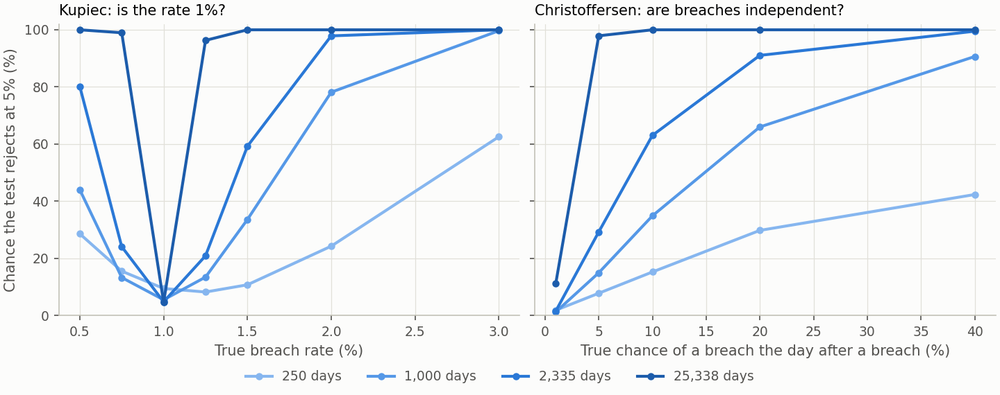

# Canary

**A risk model said losses this bad happen one day in a hundred. Count the days.**

On 25,338 trading days of the US stock market (November 1929 to September 2026), filtered historical simulation with GARCH was the only one of four models whose 1% limit was breached about 1% of the time: 258 breaches, 1.02%. Plain historical simulation was breached 1.24% of the time, and the two models that assume normal returns about 2%. Every model clustered its breaches. After a breach, the next day was another breach 9.2% of the time for historical simulation and 11.1% for the normal model, against 2.7% for the filtered model, which still fails Christoffersen's independence test at the 5% level (p = 0.024).


## Reproduce

```
uv sync
uv run python scripts/fetch_data.py
uv run python scripts/reproduce.py
```

The fetch downloads about 50 MB into `data/`. The run takes about a minute and rewrites every file in `results/`. `uv run python scripts/reproduce.py --fast` needs no data: it runs the same pipeline on a small seeded synthetic data set in a few seconds and writes to `results_fast/`. Its numbers are a smoke test and nothing more.

## The question

Every risk model produces a number. Which ones were right as often as they claimed, and which ones failed on consecutive days, when it matters most?

## What was built

- One-day value at risk and expected shortfall from four models on a rolling window of 1,000 days: historical simulation, a normal model, GARCH(1,1) with normal shocks, and filtered historical simulation with GARCH(1,1). GARCH is refitted every 21 days.
- Kupiec's test of the breach rate, and Christoffersen's tests of independence and conditional coverage.
- The power of both tests: exact for Kupiec, simulated for Christoffersen.
- One-day variance forecasts from GARCH(1,1) and HAR, scored by QLIKE against realised variance, with a Diebold-Mariano test.
- The variance risk premium from VIX, as a side study.

## Results

### Coverage of the 1% limit, US market

| Model | Breaches | Rate | Kupiec p | Next-day rate | Independence p | Followed within 5 days | Loss / forecast shortfall |
|---|---|---|---|---|---|---|---|
| Historical simulation | 314 | 1.24% | 0.0002 | 9.2% | 4e-17 | 33% | 1.04 |
| Normal | 541 | 2.14% | 5e-56 | 11.1% | 9e-26 | 38% | 1.28 |
| GARCH, normal | 512 | 2.02% | 1e-46 | 3.9% | 0.006 | 17% | 1.16 |
| Filtered historical (GARCH) | 258 | 1.02% | 0.77 | 2.7% | 0.024 | 10% | 1.05 |

253 breaches were expected. "Followed within 5 days" is the share of breaches that had another breach in the next five trading days; independent breaches at 1% would give about 5%. The last column is the mean loss on breach days divided by the mean expected-shortfall forecast on those days, so 1.28 means losses beyond the normal model's limit were 28% larger than it forecast. It is a ratio and not a test.

The two failures separate cleanly. The distribution decides the rate: both normal models were breached twice as often as stated, whether or not they tracked volatility. The volatility model decides the clustering: both GARCH models had next-day rates of 3% to 4%, and both fixed-window models had 9% to 11%.

By decade (`results/fig2_breaches_by_decade.png`), the filtered model's rate stayed between 0.85% and 1.19% in all ten decades and Kupiec's test never rejects it. Historical simulation ran at 1.5% to 2.1% from the 1970s to the 2000s and at 0.7% in the 2010s, when its window still held 2008.

With 500-day and 2,000-day windows the ordering is the same (`results/var_window_sensitivity.csv`). At the 5% limit the normal model's rate is right (4.97%) and its clustering is as bad (15% next-day rate). On 2,335 days of BTC no model fails the independence test, and the power table below says that is what a sample of that size would show for anything but severe clustering.

### How much the tests can see



Kupiec's test at the 1% level, 5% size, exact from the binomial distribution: with 250 days it rejects a model whose true rate is 2% only 24% of the time, with 1,000 days 78%, and with 25,338 days it rejects a true rate of 1.25% in 96% of samples. The independence test is weaker. Against a 10% chance of a breach the day after a breach it rejects 15% of the time with 250 days, 35% with 1,000 and 63% with 2,335 (2,000 simulations each). A year of data cannot tell these four models apart. A century can.

### GARCH(1,1) against HAR

On BTC, 2,335 forecast days from June 2020 to October 2026, realised variance from five-minute bars:

| Proxy for the true variance | QLIKE, GARCH | QLIKE, HAR | Diebold-Mariano | p |
|---|---|---|---|---|
| Realised variance | 0.383 | 0.352 | 4.00 | 0.00006 |
| Squared daily return | 1.858 | 1.829 | 3.14 | 0.0017 |

HAR has the lower loss under both proxies. The gap is not steady. The yearly mean difference was 0.04 to 0.09 in 2020 to 2022 and between -0.004 and 0.018 in each year from 2023 on (`results/vol_forecast_by_year.csv`, `results/fig4_vol_forecast.png`). Hansen and Lunde compared GARCH(1,1) with other models that use daily returns only. HAR uses intraday data, so this result does not contradict theirs.

### Variance risk premium

Over 440 months from January 1990 to August 2026, VIX squared exceeded the variance realised over the next 21 trading days in 84% of months. The mean premium was 100 annualised variance points (percent squared), the median 122, and the worst month was February 2020 at -7,270 (`results/fig5_vrp.png`). The realised leg uses daily returns of the whole US market, not intraday S&P 500 returns. Over 2016 to 2026, where S&P 500 levels are available, the market series has 5.5% more variance than the index, which lowers the mean premium by 18 points in that window (44 against 62).

## Comparison with the sources

Full detail, formulas and equation numbers are in `PAPER.md`. In brief:

- Kupiec's statistic reproduces 14 of the 16 cells of his Table 2. Two cells differ by 1 and 2 (124 printed, 125 computed; 44 printed, 42 computed). His one-year example, a 26.23% chance that a 2% model shows three or fewer breaches in 250 days, reproduces as 26.22%.
- GARCH(1,1) estimates match the `arch` package to four decimals on simulated data.
- HAR here is fitted to realised variance. Corsi's regression is on realised volatility, the square root.
- The realised leg of the variance risk premium uses daily returns of a market proxy. Bollerslev, Tauchen and Zhou use five-minute S&P 500 returns.
- The journal versions of Kupiec's paper and of the filtered historical simulation paper were not reachable. Their working-paper versions were read.

## Sources

- Kupiec, "Techniques for Verifying the Accuracy of Risk Measurement Models", Journal of Derivatives, 1995
- Christoffersen, "Evaluating Interval Forecasts", International Economic Review 39, 1998
- Bollerslev, "Generalized autoregressive conditional heteroskedasticity", Journal of Econometrics 31(3), 1986
- Corsi, "A Simple Approximate Long-Memory Model of Realized Volatility", Journal of Financial Econometrics 7(2), 2009
- Hansen and Lunde, "A forecast comparison of volatility models: does anything beat a GARCH(1,1)?", Journal of Applied Econometrics 20(7), 2005
- Diebold and Mariano, "Comparing Predictive Accuracy", Journal of Business and Economic Statistics 13(3), 1995
- Patton, "Volatility forecast comparison using imperfect volatility proxies", Journal of Econometrics 160, 2011
- Barone-Adesi, Giannopoulos and Vosper, "VaR without correlations for portfolios of derivative securities", Journal of Futures Markets 19, 1999
- Bollerslev, Tauchen and Zhou, "Expected Stock Returns and Variance Risk Premia", Review of Financial Studies 22(11), 2009

## Data

All of it is fetched by `scripts/fetch_data.py` without a key or an account, and none of it is committed.

| Series | Source | Used |
|---|---|---|
| US market daily return (Mkt-RF plus RF) | Kenneth French data library | 1926-07-01 to 2026-09-30, 26,338 days |
| VIX daily close | Cboe | 1990-01-02 to 2026-09-30 |
| S&P 500 index level | FRED | 2016-11-25 to 2026-09-30, a check on the market proxy |
| BTCUSDT five-minute bars | Binance public data archive | 2017-08-17 to 2026-10-31, 966,793 bars |

The French library file is copyright Fama and French, the VIX history belongs to Cboe, the S&P 500 series on FRED belongs to S&P Dow Jones Indices, and the bars belong to Binance. Each provider's terms apply to your own download. `results/data_manifest.csv` records the SHA-256 of each file this run used, so you can tell whether your download is the same.

The design named the VOLARE archive as a possible source of realised volatility. Its terms were not confirmed, so realised variance is computed here from the Binance bars. See `PAPER.md`.

## How it is tested

`uv run pytest` runs 80 tests. The maths was tested before any result was read.

- Independent breaches at the stated rate are rejected by each coverage test about 5% of the time.
- A Markov chain with the right long-run rate and clustered breaches passes Kupiec's test and fails Christoffersen's.
- Kupiec's statistic is checked against his printed Table 2 and against the non-rejection regions usually quoted from his paper.
- GARCH(1,1) estimates match the `arch` package, and the filter matches a plain loop.
- The normal expected shortfall matches numerical integration. Historical simulation matches the order statistic.
- No forecast changes when later returns are changed.
- Two runs of the pipeline write identical tables.

## Layout

```
src/canary/      the code
tests/             maths tests first
scripts/reproduce.py   one command rebuilds every figure and table
scripts/fetch_data.py  downloads public data into data/ (never committed)
results/           committed figures and small tables
PAPER.md           citations, claims tested, comparison with the sources
```

## Roadmap

- [x] Project skeleton, CI, and the reproduce command
- [x] Value at risk and expected shortfall by historical simulation, a normal model, and filtered historical simulation with GARCH
- [x] Kupiec's test of how often the limit was breached, and Christoffersen's test of whether breaches cluster
- [x] GARCH(1,1) against HAR volatility forecasts, scored by QLIKE with a Diebold-Mariano test
- [x] The variance risk premium from VIX, as a side study
- [x] `PAPER.md` comparison with the sources
- [x] Results and limits written up at the top of this file

## Limits

- A model can pass every backtest and fail in the next crisis. Coverage tests look backward.
- The headline is one asset: a value-weighted index of US stocks. A portfolio with options, leverage or illiquid positions is a different problem, and nothing here says the filtered model would cover it.
- The filtered model passed on the rate and still clustered. Seven of its 258 breaches were followed by a breach the next day, where independence would give about 2.6. Christoffersen's test looks one day back only, so the 10% of its breaches followed by another within five days is reported as a count with no test behind it.
- Expected shortfall has no formal backtest here. The table gives a ratio of realised to forecast loss on breach days.
- At the 1% level a year of data has little power: 24% against a model that is wrong by a factor of two. The BTC table (2,335 days) and each decade (about 2,500 days) should be read with `results/power_kupiec.csv` beside them.
- The window (1,000 days) and refit interval (21 days) were fixed before the run. Two other windows were run as a check and are counted in `PAPER.md`. A GARCH with fat-tailed shocks or asymmetry was not tried.
- GARCH against HAR is one asset, BTC, on one exchange, with 27 days dropped for exchange outages. HAR's advantage came almost entirely from 2020 to 2022.
- The variance risk premium ignores every cost of trading variance, and its realised leg comes from daily returns of a proxy index.
- The French library revises its files as CRSP is updated. A later download can differ slightly from the one behind these numbers.
- This is research code. It is not investment advice and it does not trade.

## The name

The canary in the mine was a risk model. The only question that mattered was whether it warned in time.

## Licence

MIT. See `LICENSE`.
