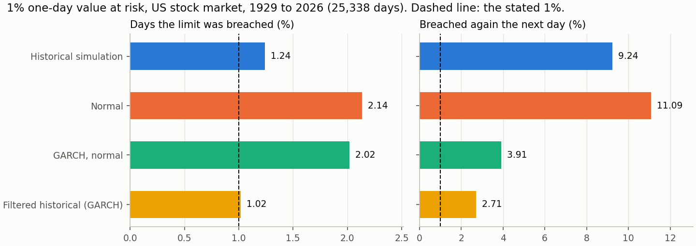

# Canary

A risk model says a loss this large should come on one day in a hundred. How often did it come, did the bad days arrive together, and were the losses beyond the limit as large as the model said?

On 25,338 trading days of the US stock market (November 1929 to September 2026), with a 1,000-day window, two of six models had a 1% limit that was breached about 1% of the time. Both are filtered historical simulation: 1.02% with a GARCH filter and 1.06% with a GJR-GARCH filter. Historical simulation was breached on 1.24% of days, GARCH with Student t shocks on 1.46%, and the two normal models on about 2%.

That ranking depends on the window, and BTC does not repeat it. With a 2,000-day window plain historical simulation also passes Kupiec's test (1.08%, p = 0.19). With a 500-day window both filtered models fail it (1.15% and 1.16%, p = 0.021 and 0.015), and the GARCH-filtered one fails the independence test as well (p = 0.007). On 2,362 days of BTC the normal model has the 1% breach rate nearest to 1% (1.10%), and historical simulation is breached too rarely (0.55%, p = 0.016).

No model gets everything right on the US market. Breaches cluster under all six at the 5% limit. At the 1% limit the GARCH-filtered model still fails the independence test (p = 0.024, or 0.045 by simulation) and the GJR-filtered one does not (p = 0.098). Losses beyond the 1% limit were 5% larger than either filtered model forecast, and both fail the conditional expected-shortfall test.



The main limit: this is one stock index, one window length chosen in advance, and tests whose verdicts change with the window. The two filtered models are the best of the six on this data, and each still fails at least one test.

## Reproduce

```
uv sync
uv run python scripts/fetch_data.py
uv run python scripts/reproduce.py
```

The fetch downloads about 50 MB into `data/`. The run takes about five minutes and rewrites every file in `results/`. `uv run python scripts/reproduce.py --fast` needs no data: it runs the same pipeline on a small seeded synthetic data set and writes to `results_fast/`. Its numbers are a smoke test and nothing more.

## What was built

One-day value at risk and expected shortfall come from six models on a rolling window of 1,000 days, with GARCH parameters refitted every 21 days:

| Model | Volatility | Distribution |
|---|---|---|
| Historical simulation | none | the window's returns |
| Normal | window standard deviation | normal |
| GARCH, normal | GARCH(1,1) | normal |
| GARCH, Student t | GARCH(1,1) | Student t, degrees of freedom estimated |
| Filtered historical (GARCH) | GARCH(1,1) | the window's standardised residuals |
| Filtered historical (GJR-GARCH) | GJR-GARCH(1,1) | the window's standardised residuals |

The first, second, third and fifth are the first version of this study. The Student t and GJR models were added on 2026-11-24, after the first results were public, together with the expected-shortfall tests. Everything added then is listed in `PAPER.md` as post hoc.

The forecasts are tested four ways. Kupiec's test asks whether the breach rate is the stated rate. Christoffersen's test asks whether a breach makes a breach the next day more likely. The Acerbi-Szekely statistics Z1 and Z2 test expected shortfall, with p-values from histories simulated out of each model's own forecast distributions. The FZ0 loss of Patton, Ziegel and Chen scores a VaR and ES pair jointly, and a Diebold-Mariano test compares each model's loss with the GARCH-filtered model's.

Two side studies use the same code: one-day variance forecasts from GARCH(1,1) and HAR on BTC, and the variance risk premium from VIX.

## Results

### Coverage of the 1% limit, US market

| Model | Breaches | Rate | Kupiec p | Next-day rate | Independence p | Followed within 5 days |
|---|---|---|---|---|---|---|
| Historical simulation | 314 | 1.24% | 0.0002 | 9.2% | 4e-17 | 33% |
| Normal | 541 | 2.14% | 5e-56 | 11.1% | 9e-26 | 38% |
| GARCH, normal | 512 | 2.02% | 1e-46 | 3.9% | 0.006 | 17% |
| GARCH, Student t | 369 | 1.46% | 8e-12 | 4.3% | 0.0002 | 15% |
| Filtered historical (GARCH) | 258 | 1.02% | 0.77 | 2.7% | 0.024 | 10% |
| Filtered historical (GJR-GARCH) | 268 | 1.06% | 0.36 | 2.2% | 0.098 | 7% |

253 breaches were expected. "Followed within 5 days" is the share of breaches that had another breach in the next five trading days. Independent breaches at 1% would give about 5%.

On this market the tail assumption set the rate. A normal tail gave 2%, a Student t tail 1.46%, and the empirical residuals about 1%, with or without a volatility model. The volatility model set the clustering: the four GARCH models had next-day rates of 2% to 4%, and the two fixed-window models 9% to 11%. BTC does not show the first pattern (see below).

By decade (`results/fig2_breaches_by_decade.png`), the GARCH-filtered model's rate stayed between 0.85% and 1.19% in all ten decades and the GJR-filtered model's between 0.88% and 1.39%. Kupiec's test rejects neither in any decade. Historical simulation ran at 1.3% to 2.1% from the 1970s to the 2000s and at 0.7% in the 2010s.

### The window changes the verdict

All three windows are scored on the same 24,338 days (`results/var_window_sensitivity.csv`).

| Window | Model | Rate | Kupiec p | Next-day rate | Independence p |
|---|---|---|---|---|---|
| 500 | Historical simulation | 1.24% | 0.0003 | 8.3% | 8e-14 |
| 500 | Filtered historical (GARCH) | 1.15% | 0.021 | 3.2% | 0.007 |
| 500 | Filtered historical (GJR-GARCH) | 1.16% | 0.015 | 1.1% | 0.88 |
| 1,000 | Historical simulation | 1.24% | 0.0003 | 9.3% | 1e-16 |
| 1,000 | Filtered historical (GARCH) | 1.03% | 0.63 | 2.8% | 0.022 |
| 1,000 | Filtered historical (GJR-GARCH) | 1.06% | 0.32 | 2.3% | 0.087 |
| 2,000 | Historical simulation | 1.08% | 0.19 | 8.7% | 2e-14 |
| 2,000 | Filtered historical (GARCH) | 1.00% | 0.98 | 2.1% | 0.14 |
| 2,000 | Filtered historical (GJR-GARCH) | 1.03% | 0.63 | 2.0% | 0.18 |

A longer window helps every empirical model on the rate. Historical simulation passes Kupiec's test at 2,000 days, though its breaches cluster as badly as before. The filtered models fail on the rate at 500 days, where the 1% quantile rests on five residuals. The normal models and the Student t model fail Kupiec's test at every window (rates 1.9% to 2.1%, and 1.3% to 1.5%). The 1,000-day window was the setting committed before the first results. The other two were run as a check.

### The 5% limit

At the 5% limit the normal model's rate is right (4.97%, Kupiec p = 0.84) and its breaches cluster (15.2% next-day rate against 5%). Both filtered models have the right rate (5.03% and 5.12%) and both cluster: 8.8% next-day for the GARCH filter, 112 consecutive pairs where independence would give 64, and 7.4% for the GJR filter, 96 pairs against 66. The asymmetric filter removes part of the clustering. It does not remove it. GARCH with Student t shocks is breached on 6.09% of days at this limit.

### BTC

2,362 days from May 2020 to October 2026, same window and settings.

| Model | 1% rate | Kupiec p | 5% rate | Kupiec p |
|---|---|---|---|---|
| Historical simulation | 0.55% | 0.016 | 3.98% | 0.018 |
| Normal | 1.10% | 0.63 | 3.09% | 5e-06 |
| GARCH, normal | 1.27% | 0.21 | 3.81% | 0.006 |
| GARCH, Student t | 0.72% | 0.15 | 5.17% | 0.71 |
| Filtered historical (GARCH) | 0.72% | 0.15 | 4.66% | 0.44 |
| Filtered historical (GJR-GARCH) | 0.72% | 0.15 | 4.66% | 0.44 |

The normal model has the best 1% rate, which is the opposite of the US result. Historical simulation is rejected at both limits for too few breaches. At 5% the normal and GARCH-normal models are also rejected for too few breaches. Only the Student t and the two filtered models pass at both limits. No model fails the independence test on BTC, and the power table says a sample of this size detects a 5% next-day rate at the 1% limit less than a third of the time.

### Expected shortfall

US market, 1% limit. Z1 and Z2 are zero in expectation for a correct model and negative when losses beyond the limit are larger or more frequent than forecast. Each p-value is the share of 1,000 simulated histories with a statistic at or below the observed one, so 0.001 is the smallest value possible.

| Model | Loss / forecast shortfall | Z1 | p | Z2 | p | FZ0 loss minus GARCH-filtered | Diebold-Mariano |
|---|---|---|---|---|---|---|---|
| Historical simulation | 1.04 | -0.063 | 0.002 | -0.317 | 0.001 | +0.296 | 7.4 |
| Normal | 1.28 | -0.289 | 0.001 | -1.753 | 0.001 | +0.568 | 6.7 |
| GARCH, normal | 1.16 | -0.172 | 0.001 | -1.368 | 0.001 | +0.157 | 6.7 |
| GARCH, Student t | 1.01 | -0.021 | 0.13 | -0.487 | 0.001 | +0.028 | 3.1 |
| Filtered historical (GARCH) | 1.05 | -0.060 | 0.001 | -0.080 | 0.12 | | |
| Filtered historical (GJR-GARCH) | 1.05 | -0.069 | 0.001 | -0.130 | 0.024 | -0.027 | -2.7 |

No model passes both tests. Z1 looks only at breach days. The Student t model passes it, so its shortfall given a breach was about right, and it fails Z2 because it had 369 breaches where 253 were expected. The GARCH-filtered model passes Z2 and fails Z1: its breaches came at the right rate and lost 5% more than it forecast. The GJR-filtered model fails both, though it has the lowest FZ0 loss of the six (Diebold-Mariano -2.7 against the GARCH-filtered model at 1%, -9.3 at 5%). At the 5% limit the GARCH-filtered model is the only one not rejected by Z2 at the 5% level (p = 0.21), and its Z1 p-value is 0.042.

Z1 is harsh on a long sample, and `results/es_test_size.csv` measures how harsh. On independent draws from a fixed distribution, where a rolling window is the right model, historical simulation is rejected by Z1 in 73 of 100 replications of 25,338 days with normal draws and in 67 of 100 with Student t draws. The mean Z1 there is -0.014 and -0.034, because a shortfall estimated from the ten smallest of 1,000 returns comes out a little too small. Part of the -0.06 to -0.07 for the three empirical models in the table is therefore this estimation error, and the table cannot say how much is the filter's fault. Z2 was rejected in none of the same replications, so it is conservative here.

On BTC the two normal models fail Z1 at both limits (p = 0.001). The other four pass both tests, with positive statistics: their shortfall forecasts were larger than the losses that came.

### How much the tests can see


Kupiec's test at the 1% level, 5% size, exact from the binomial distribution: with 250 days it rejects a model whose true rate is 2% only 24% of the time, with 1,000 days 78%, and with 25,338 days it rejects a true rate of 1.25% in 96% of samples. The independence test is weaker. Against a 10% chance of a breach the day after a breach it rejects 15% of the time with 250 days, 35% with 1,000 and 63% with 2,362 (2,000 simulations each). A year of data cannot tell these models apart.

The independence test has a problem of its own in a long sample at 1%. With 25,338 days it rejected independent breaches 11% of the time, because a series with no consecutive breaches at all has fewer than chance and counts as a rejection. `results/var_coverage.csv` therefore also gives a simulated p-value and a one-sided p-value on the number of consecutive pairs, from 10,000 simulated series. For the GARCH-filtered model they are 0.045 and 0.019, and for the GJR-filtered model 0.109 and 0.074.

### GARCH(1,1) against HAR

On BTC, 2,344 scored days from May 2020 to October 2026, realised variance from five-minute bars:

| Proxy for the true variance | QLIKE, GARCH | QLIKE, HAR | Diebold-Mariano | p |
|---|---|---|---|---|
| Realised variance | 0.383 | 0.352 | 3.99 | 0.00007 |
| Squared daily return | 1.853 | 1.826 | 3.11 | 0.0019 |

HAR has the lower loss under both proxies. The gap is not steady. The yearly mean difference was 0.05 to 0.08 in 2020 to 2022 and between -0.004 and 0.022 in each year from 2023 on (`results/vol_forecast_by_year.csv`, `results/fig4_vol_forecast.png`). Hansen and Lunde compared GARCH(1,1) with other models that use daily returns only. HAR uses intraday data, so this result does not contradict theirs.

Exchange outages left 27 days without enough bars for a realised variance, 9 of them in the forecast period. Those days stay in the series as gaps. GARCH runs on the daily returns, which exist for every day. HAR averages the days present in each lag window and makes no forecast for the day after a gap. A day is scored when it has a realised variance and a HAR forecast, which leaves 2,344 of 2,362. The first version dropped the 27 days and treated their neighbours as consecutive. Fixing that moved the Diebold-Mariano statistic from 4.00 to 3.99.

### Variance risk premium

Over 439 months from February 1990 to August 2026, VIX squared exceeded the variance realised over the next 30 calendar days in 85% of months. The mean premium was 114 annualised variance points (percent squared), the median 127, and the worst month was February 2020 at -7,274 (`results/fig5_vrp.png`). The Newey-West t-statistic of the mean is 4.3 with 5 lags.

The realised leg covers the same 30 calendar days as VIX. It uses daily returns of the whole US market, not intraday S&P 500 returns. Over 2016 to 2026, where S&P 500 levels are available, the market series has 5.5% more variance than the index, which lowers the mean premium by 18 points in that window (50 against 68). The premium ignores every cost of trading variance.

## Comparison with the sources

Formulas, equation numbers and the full list of differences are in `PAPER.md`. In brief:

- Kupiec's statistic reproduces 14 of the 16 cells of his Table 2. Two cells differ by 1 and 2 (124 printed, 125 from his formula; 44 printed, 42). The test computes his formula a second way, from scipy's binomial distribution, and checks the code and the printed table against that. His one-year example, a 26.23% chance that a 2% model shows three or fewer breaches in 250 days, reproduces as 26.22%.
- GARCH(1,1) estimates match the `arch` package within 0.0005 on simulated data, and the GJR and Student t estimates within 0.002.
- Acerbi and Szekely count a simulated breach with a strict inequality for continuous distributions and give a correction for others. A window of returns is not continuous, so the simulation here counts a draw equal to the limit as a breach.
- The variance risk premium over 1990 to 2007 has nearly the same implied leg as Bollerslev, Tauchen and Zhou (33.14 against their 33.23, monthly units) and a larger realised leg (20.68 against 14.93), so a smaller premium (12.5 against 18.3).
- HAR here is fitted to realised variance. Corsi's regression is on realised volatility, the square root.
- The journal versions of Kupiec's paper and of the filtered historical simulation paper were not reachable. Their working-paper versions were read. The GJR and Student t GARCH papers were not read. Those two models are written from the standard definitions and checked against the `arch` package.

## Sources

- Kupiec, "Techniques for Verifying the Accuracy of Risk Measurement Models", Journal of Derivatives, 1995
- Christoffersen, "Evaluating Interval Forecasts", International Economic Review 39, 1998
- Bollerslev, "Generalized autoregressive conditional heteroskedasticity", Journal of Econometrics 31(3), 1986
- Acerbi and Szekely, "Backtesting Expected Shortfall", MSCI, December 2014
- Patton, Ziegel and Chen, "Dynamic semiparametric models for expected shortfall (and Value-at-Risk)", arXiv:1707.05108, 2017
- Corsi, "A Simple Approximate Long-Memory Model of Realized Volatility", Journal of Financial Econometrics 7(2), 2009
- Hansen and Lunde, "A forecast comparison of volatility models: does anything beat a GARCH(1,1)?", Journal of Applied Econometrics 20(7), 2005
- Diebold and Mariano, "Comparing Predictive Accuracy", Journal of Business and Economic Statistics 13(3), 1995
- Patton, "Volatility forecast comparison using imperfect volatility proxies", Journal of Econometrics 160, 2011
- Barone-Adesi, Giannopoulos and Vosper, "VaR without correlations for portfolios of derivative securities", Journal of Futures Markets 19, 1999
- Bollerslev, Tauchen and Zhou, "Expected Stock Returns and Variance Risk Premia", Review of Financial Studies 22(11), 2009

## Data

All of it is fetched by `scripts/fetch_data.py` without a key or an account, and none of it is committed.

| Series | Source | Used |
|---|---|---|
| US market daily return (Mkt-RF plus RF) | Kenneth French data library | 1926-07-01 to 2026-09-30, 26,338 days |
| VIX daily close | Cboe | 1990-01-02 to 2026-09-30 |
| S&P 500 index level | FRED | 2016-11-25 to 2026-09-30, a check on the market proxy |
| BTCUSDT five-minute bars | Binance public data archive | 2017-08-17 to 2026-10-31, 966,793 bars |

The French library file is copyright Fama and French, the VIX history belongs to Cboe, the S&P 500 series on FRED belongs to S&P Dow Jones Indices, and the bars belong to Binance. Each provider's terms apply to your own download. `results/data_manifest.csv` records the SHA-256 of each file this run used, so you can tell whether your download is the same.

## How it is tested

`uv run pytest` runs 116 tests.

- Independent breaches at the stated rate are rejected by each coverage test about 5% of the time.
- A Markov chain with the right long-run rate and clustered breaches passes Kupiec's test and fails Christoffersen's.
- Kupiec's statistic is checked against a second implementation, against his printed Table 2, and against the non-rejection regions usually quoted from his paper.
- The Acerbi-Szekely statistics have mean zero for a correct model, reject a correct model about 5% of the time, and reject a normal model on fat-tailed data.
- The expected FZ0 loss at the true VaR and ES equals log(ES), and every other pair tried scores worse.
- GARCH, GJR and Student t estimates match the `arch` package. The filter matches a plain loop, and the Student t likelihood matches scipy's density.
- The normal and Student t expected shortfall match numerical integration. Historical simulation matches the order statistic.
- A missing day in the realised-variance series stays a gap: the HAR fit equals a direct regression on the valid pairs and differs from a fit on the closed-up series.
- The Newey-West t-test rejects a true zero mean near 5% of the time on a persistent series, where the iid t-test rejects more than 20%.
- No forecast changes when later returns are changed, or when the null simulation is switched on.
- Two runs of the pipeline write identical tables.

## Layout

```
src/canary/            the code
tests/                 the tests
scripts/reproduce.py   one command rebuilds every figure and table
scripts/fetch_data.py  downloads public data into data/ (never committed)
results/               committed figures and small tables
PAPER.md               formulas, sources, differences from them, what is post hoc
```

## Limits

- A model can pass every backtest and fail in the next crisis. Coverage tests look backward.
- The headline is one asset, a value-weighted index of US stocks, and it does not repeat on BTC. A portfolio with options, leverage or illiquid positions is a different problem.
- The verdicts move with the window. At 500 days the filtered models fail on the rate, and at 2,000 days historical simulation passes on it.
- Twelve model and limit combinations are tested on the US market with four tests each, and no correction is made for that. A p-value of 0.02 to 0.1 in these tables is weak evidence either way.
- The Student t and GJR models, the expected-shortfall tests, and the fixes to the volatility and variance-premium studies were added after the first results had been seen.
- The Z1 test rejects a correctly specified window model more than half the time in a sample this long, so its rejections of the three empirical models overstate their fault. No correction is applied.
- Christoffersen's test looks one day back only. The share of breaches followed by another within five days is reported as a count with no test behind it.
- At the 1% level a year of data has little power: 24% against a model that is wrong by a factor of two. The BTC tables (2,362 days) and each decade (about 2,500 days) should be read with `results/power_kupiec.csv` beside them.
- Rolling Student t fits can sit on the persistence cap. The full-sample BTC fit does (`results/garch_full_sample.csv`), with 3.2 degrees of freedom.
- GARCH against HAR is one asset, BTC, on one exchange. HAR's advantage came almost entirely from 2020 to 2022.
- The French library revises its files as CRSP is updated. A later download can differ slightly from the one behind these numbers.
- This is research code. It is not investment advice and it does not trade.

The name: a canary in a mine was a risk model, and its job was to warn in time.

## Licence

MIT. See `LICENSE`.
